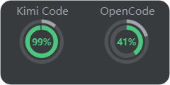
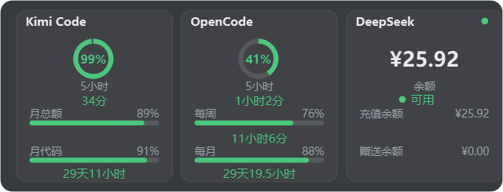
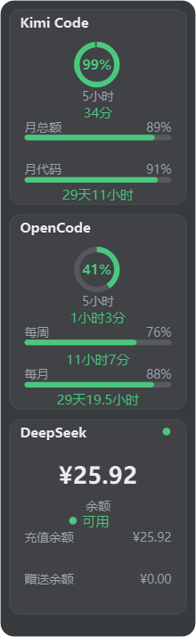

# AI Quota Widget（Kimi Code / OpenCode / DeepSeek 用量悬浮窗）

Windows 桌面常驻小组件：始终置顶，实时展示 **Kimi Code / OpenCode / DeepSeek**
的额度与重置倒计时。它是自托管用量面板
[OpenUsage](https://github.com/ellite/openusage) 的**纯显示层客户端**——不接触
任何上游 API 密钥，额度采集全部由你的 OpenUsage 实例完成。




左右贴边时自动切换竖排：


## 功能

- **展开面板**：左、右贴边时三个服务上下排列，其他位置横排。
  Kimi（5h 主环 + 月总额/月代码额度条 + 月重置）、
  OpenCode（5h 主环和倒计时 + 每周/每月额度条 + 月重置倒计时）、DeepSeek（大字余额 +
  充值/赠送余额）。悬浮提示显示数据状态，单服务断线时该服务的额度环变灰。
- **贴边收起**：拖到屏幕边缘 10px 内松手，贴上、下边时横排（192×96），
  贴左、右边时竖排（96×192）。Kimi 与 OpenCode 各占一个 96×96 单元：
  **内环**=5h 剩余额度（阈值色）、
  **外环**=距 5h 重置的倒计时（中性色）、环心=剩余百分比。悬停滑出面板，
  移开 1.5 秒收回，拖离边缘退出贴边。形变动画几何与内容同帧插值，可中断续播。
- **按服务独立双速轮询**：空闲档每 3 分钟读服务端缓存；任一服务的额度/余额/状态
  变化即切活动档——每 1 分钟仅对该服务单服务 force 回源（其他服务不打上游）；
  连续 3 次静默逐服务退出。手动「立即刷新」全量 force 一次覆盖三服务。
- **低额度提醒**：5h 剩余 <10% 时迷你卡内环缓慢闪烁（右键菜单可关）。
- 401 自动重登录；位置、贴边状态、闪烁开关全部本地记忆。
- **渲染分层（v1.2）**：静态内容（卡片骨架/标题/明细/余额）按数据签名缓存为
  Pixmap，仅额度环、环心数字与倒计时文字逐帧重绘；形变动画只插值几何与透明度，
  中途反向无缝续播。

## 前置条件

需要一个已部署并可访问的 [OpenUsage](https://github.com/ellite/openusage) 实例
（≥ v1.9.0），并在其中通过「自定义 API」接入 Kimi Code。字段配置（路径为 Kimi
原生响应结构，悬浮窗按 path 后缀匹配、标签兜底）：

| 标签 | 路径 | 类型 |
|---|---|---|
| 5 小时剩余 | `usages.limit_5h.used_ratio` | 百分比环（0–1 小数） |
| 月总额度剩余 | `usages.limit_month_total.used_ratio` | 百分比（0–1 小数） |
| 月代码额度剩余 | `usages.limit_month_code.used_ratio` | 百分比（0–1 小数） |
| 5 小时重置 | `usages.limit_5h.reset_time` | 重置时间 |
| 月额度重置 | `usages.limit_month_total.reset_time` | 重置时间 |

> 注意：悬浮窗的登录**不支持两步验证**的账号——请在 OpenUsage 中为专用账号关闭 2FA。

## 安装

**方式一：下载可执行文件**（免 Python 环境）

从 [Releases](../../releases) 下载 `KimiQuotaWidget.exe`（单文件，双击运行）。

**方式二：源码运行**（Python ≥ 3.10，Windows）

```sh
git clone https://github.com/Martin-ding0918/kimi-quota-widget.git
cd kimi-quota-widget
pip install -r requirements.txt
python main.py
```

首次运行会弹出设置对话框：填入 OpenUsage 地址（默认 `http://localhost:4188`）、
用户名、密码。密码存 Windows 凭据管理器，token 存 `%APPDATA%\kimi-quota-widget\`，
**不落任何明文文件**。

## 使用

- 按住拖动悬浮窗；松手时距屏幕边缘 10px 内自动吸附收起。
- 右键菜单：立即刷新 / 贴边收起⇄取消贴边 / 低额度闪烁提醒 / 开机自启（HKCU Run）/
  设置 / 打开 OpenUsage 面板 / 退出。
- 打包发布：`pip install pyinstaller` 后
  `pyinstaller --windowed --onefile --name KimiQuotaWidget main.py`。

## 开发与测试

```sh
python -m unittest discover -s tests -v
```

154 项单元测试覆盖额度解析与换算、贴边几何、双速轮询档位判定、登录/401 重登录、
错误分支等纯逻辑（目标平台即 Windows，本机直接跑）。GUI 部分人工验收。

## 许可

[GPL-3.0](LICENSE)。本工具是 OpenUsage 的独立客户端，不含其代码；感谢
[ellite/openusage](https://github.com/ellite/openusage) 提供的优秀自托管面板。
