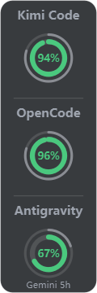

# AI Quota Widget（OpenUsage 用量悬浮窗）

Windows 桌面常驻小组件：始终置顶，展示所选服务的额度、余额与重置倒计时。
它是自托管用量面板
[OpenUsage](https://github.com/ellite/openusage) 的**纯显示层客户端**——不接触
任何上游 API 密钥，额度采集全部由你的 OpenUsage 实例完成。


左右贴边时自动切换竖排：


## 功能

- **显示服务**：在「设置 → 显示服务」中勾选、排序，并选择最多三张迷你卡。
  选择按服务器和帐户分别保存，同一家服务商的多个账号可以独立显示。
- **展开面板**：单服务只占一张卡。浮动和上、下贴边时，2～3 张横排，4 张起为两列网格。
  左、右贴边时上下排列，超出屏幕可用高度可用滚轮查看。Kimi、OpenCode、DeepSeek 和
  Antigravity 保留专用指标（Antigravity 主环展示剩余最低的 5 小时池，副条展示另一 5 小时池与最紧缺的周限额），其他服务显示可以从接口识别的余额、额度和重置日期。
- **贴边收起**：拖动窗口，松手时指针或窗口靠近屏幕边缘即可贴边。贴边后可沿边移动或拖到另一侧；恢复浮窗时在右键菜单选择「取消贴边」。
  迷你卡悬停展开，移开约 1.5 秒收回。额度环用弧长表示剩余百分比，已知重置周期时外环显示倒计时。
- **按服务刷新**：空闲每 3 分钟读缓存，额度有变化时每分钟强刷对应服务，
  连续三次无变化退出活动档。「立即刷新」仅强刷已选服务。
- **低额度提醒**：剩余 <10% 时额度环闪烁，可在右键菜单关闭。
- **状态提示**：刷新中右上角显示小蓝点；右键菜单顶部显示最近更新时间和当前轮询档位，
  并可切换背景不透明度（100/95/85/70）。
- **单实例**：开机自启已在运行时，再次启动只提示“已在运行”，不会出现第二套卡片。
- **连接安全**：`localhost`、`127.0.0.1`、`::1` 的 HTTP 直接允许；其他 HTTP 地址
  保存设置时需勾选「允许不安全的 HTTP」，密码和 token 会明文传输。建议通过
  反向代理为 OpenUsage 启用 HTTPS。
- 401 自动重登录。失败时保留最近取得的用量，卡片显示数据状态，具体原因见右键菜单「错误详情」。

## 前置条件

需要一个已部署并可访问的 [OpenUsage](https://github.com/ellite/openusage) 实例
（≥ v1.9.0），并在其中添加要查看的服务。如果使用「自定义 API」接入 Kimi Code，
字段配置如下（路径为 Kimi
原生响应结构，悬浮窗按 path 后缀匹配、标签兜底）：

| 标签 | 路径 | 类型 |
|---|---|---|
| 5 小时剩余 | `usages.limit_5h.used_ratio` | 百分比环（0–1 小数） |
| 月总额度剩余 | `usages.limit_month_total.used_ratio` | 百分比（0–1 小数） |
| 月代码额度剩余 | `usages.limit_month_code.used_ratio` | 百分比（0–1 小数） |
| 5 小时重置 | `usages.limit_5h.reset_time` | 重置时间 |
| 月额度重置 | `usages.limit_month_total.reset_time` | 重置时间 |

> 注意：悬浮窗的登录**不支持两步验证**的账号——请在 OpenUsage 中为专用账号关闭 2FA。

> 传输安全：非回环地址的 HTTP 连接需要在设置中显式允许（密码和 token 明文传输），
> 建议通过反向代理为 OpenUsage 启用 HTTPS。

> Antigravity：先在 OpenUsage 中添加 Google Antigravity 服务（Google OAuth PKCE，
> 或导入 refresh token/凭据 JSON）；悬浮窗只读取 `/api/usage` 的额度池，不接触
> Google 凭据。

## 安装

**方式一：下载可执行文件**（免 Python 环境）

从 [Releases](../../releases) 下载 `KimiQuotaWidget.exe`（单文件，双击运行）。

**方式二：源码运行**（Python ≥ 3.10，Windows）

```sh
git clone https://github.com/Martin-ding0918/ai-quota-widget.git
cd ai-quota-widget
pip install -r requirements.txt
python main.py
```

首次运行会弹出设置对话框：填入 OpenUsage 地址（默认 `http://localhost:4188`）、
用户名、密码。密码和 token 存 Windows 凭据管理器。服务选择和位置保存在
`%APPDATA%\kimi-quota-widget\config.json`。

## 使用

- 按住拖动悬浮窗；松手时距屏幕边缘 10px 内自动吸附收起。
- 右键菜单：立即刷新 / 贴边收起⇄取消贴边 / 低额度闪烁提醒 / 开机自启（HKCU Run）/
  背景不透明度 / 设置 / 打开 OpenUsage 面板 / 退出。
- 打包发布：`pip install pyinstaller` 后
  `python -m PyInstaller --clean --noconfirm KimiQuotaWidget.spec`，
  产物在 `dist/KimiQuotaWidget.exe`。

## 开发与测试

```sh
python -m unittest discover -s tests -v
```

逻辑测试在 NAS 隔离容器运行。Qt 测试使用带 PySide6 的容器，Windows 实机验收贴边、
设置、滚动和 DPI 缩放行为。

## 许可

[GPL-3.0](LICENSE)。本工具是 OpenUsage 的独立客户端，不含其代码；感谢
[ellite/openusage](https://github.com/ellite/openusage) 提供的优秀自托管面板。
